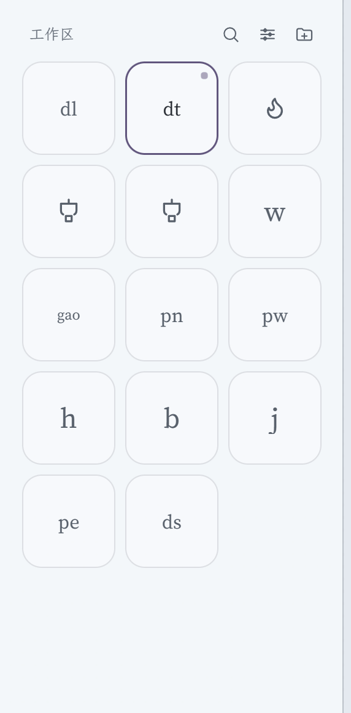
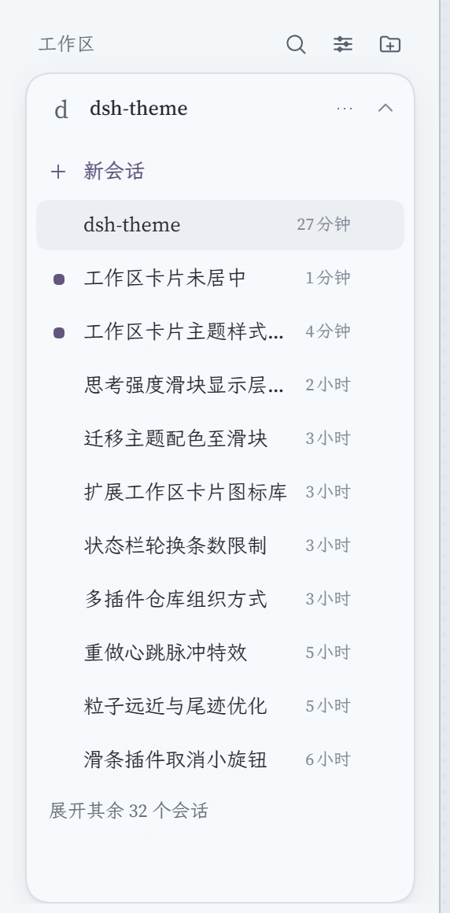
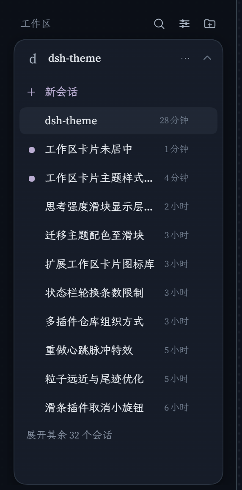
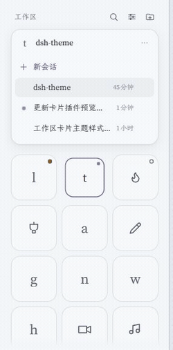

# dsh-workspace-cards

AveritA 的 DSH 侧栏插件：把「工作区」区换成**图标网格**；点卡片原地放大成会话面板，点标题收回。

> 浏览器半（`client.js`）以 priority `-1` 接管官方 `sidebar.workspaces` 座位；
> Host 半（`index.js`）只做一件事：把 `~/.dsh/workspace-icons/*.svg` 读给页面。
> Host 没装或没重启时，文件图标位为空，其余功能照常。

| 网格 | 展开的卡片 | 展开（深色） |
| --- | --- | --- |
|  |  |  |

左起：网格、展开的卡片、深色下的展开卡片。下面这段是实机演示——首字母字标、悬停出名称、点卡片展开、点标题收回：



## 形态

- **网格**：每张卡片固定为正方形（默认 76×76），列数按栏宽与卡片大小自动排（`auto-fill`），一行排不满时整行**居中**；
  统一底色（不按工作区上色）、圆角默认 21%（0% = 方块，50% = 整圆）、图标默认 26px。三者在「设置 → 工作区卡片」里调。
- **名称**：默认**仅悬停**——平时只显示图标，指针停上去时名字浮在卡片底部；图标过大时先把图标上移，仍放不下才等比缩小。可在设置里改成常显。
- **角标**：一卡一枚，实心 = 待你处理，脉冲点 = 运行中，空心环 = 未读完成；外圈带 2px 卡片底色描边，压到图标上也不会糊成一片。
- **点卡片**：卡片用 240ms 缩放动画**原地放大**成铺满网格区的面板（圆角 20px），
  盖住其它卡片；点标题行任意处收回（右侧 `⌃` 只是提示，不可单独点击），动画缩回原卡片位置。面板是**粘的**——
  选完会话不收回。
- **条数按高度铺满**：会话行按面板可视高度算（约 11 条），放不下的收进「展开其余 N 个会话」。
- **截断滚动**：标题、路径、卡片小字标签被截断时，悬停按 0.05px/ms 横向滚到末端，指针离开回到开头。
- **路径随标题展开**：路径默认收起；鼠标停在标题行时整块向下展开露出完整路径，标题与路径共用同一块高亮（底角 14px）。
- **复制路径**：标题行「⋯」菜单里第一项就是「复制路径」。
- **一个页面**：区头始终是「工作区 ⌕ ⊞ ＋」，不随展开切换；搜索也只是临时顶替网格区。
- **视图选项**：只负责排布与筛选——排序（手动 / 最近活跃）、归档（隐藏 / 全部 / 仅已归档）。
- **设置页**：「设置 → 工作区卡片」管外观：卡片大小（56–120 px）、圆角（0–50%，按边长百分比）、图标大小（14–40 px）三个滑块，
  名称（常显 / 仅悬停）、滚动条（显示 / 隐藏）两个开关，加一个「恢复默认」；带三张卡片的实时预览，拖动即时生效。
- **图标**：字符（汉字 / 字母 / emoji）、内置 36 个线性图标、自定义 SVG（粘贴 / 选文件 / 让 agent 存文件）。
- **搜索**：标题 + 工作区名本地匹配，另接 `ctx.sessions.search` 做内容搜索（250ms 防抖）。
- **窄栏**：侧栏折叠时退化成单列图标。

## 样式接口（皮肤插件用）

> 从 0.2.0 起。下面这些是**承诺**；其它类名和 DOM 层级算内部实现，皮肤别依赖。

**门控**：插件挂上挂 `html[data-dwc-api="1"]` + `html[data-dwc-version="0.2.0"]`，卸载时一起摘掉。
皮肤的规则统一用 `html[data-dwc-api="1"]` 开头——基座没装、或将来接口不兼容，整段皮肤不生效，不会半残。

**DOM**

```
.dwc-grid                     网格容器
  .dwc-tile[data-ws-id]       卡片（button）
    .dwc-tile-paint           空绘制层：皮肤在这画动态底 / 纹理
    .dwc-tile-icon            图标
    .dwc-tile-name-wrap       名称
      .dwc-tile-name
    .dwc-badge[data-kind]     角标，kind：pending / running / done
.dwc-panel                    展开的面板
  .dwc-panel-paint            空绘制层
  .dwc-panel-inner
```

状态类：`is-current`（当前工作区）、`is-names-hover`（名称仅悬停）、`is-dragging`、`is-drop`；另有 `:hover` / `:focus-visible`。

**涂装变量**：基座只把变量写进 `var()` 的兜底位，不直接写死值；皮肤在任意祖先上赋值就生效。

| 作用域 | 变量 | 默认 |
| --- | --- | --- |
| 卡片 | `--dwc-tile-bg` / `--dwc-tile-bg-hover` | `bg-layer-2` / `bg-layer-1` |
| 卡片 | `--dwc-tile-ring` / `--dwc-tile-ring-hover` / `--dwc-tile-ring-current` | 1px 内描边 / 1px 描边 + 投影 / 1.5px 主题色 |
| 卡片 | `--dwc-tile-label` / `-hover` / `-current`、`--dwc-focus-ring` | 次级文字 / 主文字 / 主题色 |
| 角标 | `--dwc-badge-ring` / `-hover`、`--dwc-badge-size` | 跟随卡片底色 / 7px |
| 角标 | `--dwc-badge-pending` / `-running` / `-done` | warn / business / success |
| 名称 | `--dwc-name-label` / `-hover`、`--dwc-name-font`、`--dwc-glyph-font` | caption / secondary / 继承 / 衬线栈 |
| 网格 | `--dwc-grid-gap`、`--dwc-grid-bg` | 8px / transparent |
| 面板 | `--dwc-panel-bg`、`--dwc-panel-bg-image`、`--dwc-panel-ring`、`--dwc-panel-shadow` | bg-base / 叠一层 bg-layer-1 / 1px 描边 / shadow-lv2 |

`--dwc-card-size` / `--dwc-card-radius` / `--dwc-icon-size` 归设置页，皮肤别改（会和滑块打架）。

**级联约定**：基座只用单类选择器、不用 `!important`。皮肤加 `html[data-dwc-api="1"]` 前缀就稳定压过，
**不依赖两个插件谁先加载**。别用 `@layer`——宿主 CSS 未分层，进层的普通声明会被宿主压掉。

**画动态底**：给 `.dwc-tile-paint` 写背景和动画即可。它绝对定位、`pointer-events: none`、继承卡片圆角；
内容层在它上面（图标 `z-index: 1`、角标 `2`），不会盖住文字。用不透明绘制层时，
把 `--dwc-badge-ring` / `-hover` 设成绘制层边缘色，角标描边才切得干净。

```css
html[data-dwc-api="1"] {
  --dwc-tile-bg: #fff;
  --dwc-badge-ring: #fff;
  --dwc-badge-ring-hover: #fff;
  --dwc-name-font: "Songti SC", serif;
}
html[data-dwc-api="1"] .dwc-tile-paint {
  background: conic-gradient(from 0deg, #b98ce622, #7cc7e822, #61567d22, #b98ce622);
  background-size: 200% 200%;
  animation: skin-drift 6s ease-in-out infinite alternate;
}
@keyframes skin-drift { from { background-position: 0% 0%; } to { background-position: 100% 100%; } }
@media (prefers-reduced-motion: reduce) {
  html[data-dwc-api="1"] .dwc-tile-paint { animation: none; }
}
```

## 存储

浏览器 `localStorage` 键 `dsh.workspaceCards.v1`：

```json
{
  "v": 3,
  "icons": { "<workspaceId>": { "kind": "char|lib|svg", "value": "..." } },
  "order": ["<workspaceId>", "..."],
  "showNames": false,
  "scrollbars": "show",
  "cardSize": 76,
  "radius": 21,
  "iconSize": 26,
  "sort": "manual",
  "archived": "hide"
}
```

`radius` 是占边长的百分比：`0` 方块，`50` 整圆，默认 `21`（76 宽时约 16px）。
卡片顺序只存在本地——`ctx.workspaces` 没有工作区重排接口，官方顺序无法回写 Host。
`v` 是存档版本：v1（没有 `v`）的「名称常显」会迁移成 v2 的「仅悬停」；v2 的 `radius` 是像素，读盘时按边长换算成 v3 的百分比。

## 文件图标（让 agent 画）

「设置图标 → 自定义 SVG → 让 agent 画」会把一段提示词复制到剪贴板。提示词里带工作区名 / 路径、
24×24 线稿约束和真实落点：

```
~/.dsh/workspace-icons/<workspaceId>.svg
```

把提示词交给 agent；它写好文件后，图标页每 2s、网格每 5s 轮询一次（页面可见时；
图标页也可点「刷新」）载入。文件图标是**只读**的：删掉文件即移除，不能从 UI 里“清除”。

- 文件图标与本地自定义同时存在时，**本地自定义优先**；点「改用文件图标」会清掉本地覆盖，
  露出文件图标。
- 只认顶层 `<workspaceId>.svg`；单文件上限 256 KiB，全部上限 4 MiB。目录可用 patch 行的
  `config.iconDir` 覆盖，默认 `~/.dsh/workspace-icons`。
- Host 半改动后需要重启 DSH 才生效；agent 需要对该目录有写权限。目录不存在时 Host 会创建，
  文件名只接受 `[A-Za-z0-9_-]`。
- 目录里的 SVG 在渲染前仍走客户端的 `sanitizeSvg`（去脚本 / 外链属性）；写坏了只会影响那一张。

## 未做 / 已知限制

- **每工作区配色**：这一版统一底色，颜色那套没接（存储里也不再写 `colors`）。
- **会话重命名、置顶**：没接。`ctx.sessions.using + rename` 与 `ctx.uiWorkspace.pinSession`
  在不同版本里是否存在需要实例核实。
- **文件图标**：只认顶层 `<workspaceId>.svg`，不支持子目录或其它文件名；Host 半没加载时
  文件图标不显示，本地图标照常。agent 写文件受会话沙箱限制，没写权限时按提示词的退路贴代码。
- **未分组会话**：工作区被删后落进「未分组」的会话不显示，因为网格只遍历已登记工作区。
- **第三方行内扩展**：替换座位后，别的插件挂在 `sidebar.session.row.*` / `sidebar.workspaces.session.*`
  上的东西不会渲染（slot 的「声明即认领」规则）。当前 profile 里没有这类插件。
- **字标**：默认只取首字母（`dsh-theme` → `d`）；同屏撞车时才加长——
  两位按「分段取首字母 / 单段取前两字」（`dsh-theme` → `dt`，`gaotie` → `ga`），
  仍重复再补到三位（`gaotie` → `gao`，`gonglingzhishou-aii` → `gai`）。

## 安装 / 卸载

```bash
# 安装（或在 DSH「设置 → 插件」里给绝对路径）
dsh plugin --profile desktop add link:D:\Documents\HTA\My Projects\dsh-workspace-cards
```

卸载后官方工作区列表原样回来（本插件不写官方任何状态）；`~/.dsh/workspace-icons` 里的文件不会删除。

## 文件

| 文件 | 作用 |
| --- | --- |
| `index.js` | Host 半：`/dsh-workspace-cards/icons` 路由，读 `~/.dsh/workspace-icons` |
| `client.js` | 全部 UI：样式、网格、抽屉、图标面板、设置页、文件图标轮询、提示词复制、搜索、菜单 |
| `cordis.patch.yml` | bundle patch：插入 `workspace-cards` 一行 |
| `locale/*.json` | 插件管理器的标题 / 描述 |
| `icon.svg` | 插件管理器图标 |
