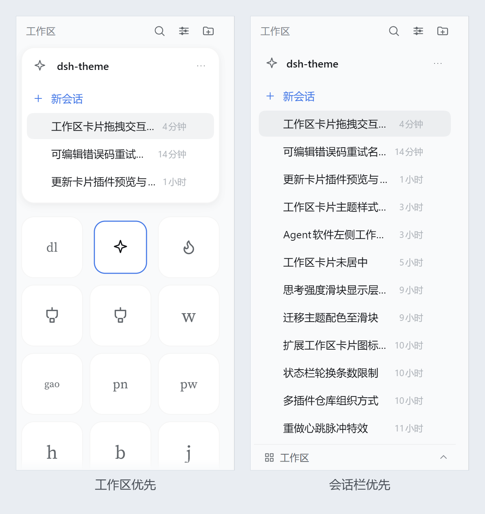

# dsh-workspace-cards

AveritA 的 DSH 侧栏插件：把「工作区」区换成**图标网格**，当前工作区**常驻**在网格上方；点任意卡片把它换到常驻位。右上角「视图选项」可在两种视口间切换：**工作区优先**（卡片常驻、会话浮窗）与**会话栏优先**（会话铺满、卡片收进底部按钮）。

> 浏览器半（`client.js`）以 priority `-1` 接管官方 `sidebar.workspaces` 座位；
> Host 半（`index.js`）只做一件事：把 `~/.dsh/workspace-icons/*.svg` 读给页面。
> Host 没装或没重启时，文件图标位为空，其余功能照常。

| 网格（常驻卡片收起） | 常驻卡片展开 | 深色 |
| --- | --- | --- |
|  |  |  |

左起：点一下收起后全部卡片回到网格、当前工作区常驻在网格上方、同一状态的深色。

下面这段是实机演示——悬停出名称 → 右上角切到「会话栏优先」 → 底部按钮拉开卡片抽屉 → 再切回来：


> 第一行从左到右：实心 = 待你处理，脉冲点 = 运行中，空心环 = 未读完成。
>
> 截图与演示都取自基座本身，没有装 `dsh-workspace-cards-skin`
> （皮肤会在运行中的工作区卡片里用 canvas 画流光，静帧里像噪点）。
## 形态

- **网格**：每张卡片固定为正方形（默认 76×76），列数按栏宽与卡片大小自动排（`auto-fill`），一行排不满时整行**居中**；
  统一底色（不按工作区上色）、圆角默认 21%（0% = 方块，50% = 整圆）、图标默认 26px。三者在「设置 → 工作区卡片」里调。
- **名称**：默认**仅悬停**——平时只显示图标，指针停上去时名字浮在卡片底部；图标过大时先把图标上移，仍放不下才等比缩小。可在设置里改成常显。
- **角标**：一卡一枚，实心 = 待你处理，脉冲点 = 运行中，空心环 = 未读完成；外圈带 2px 卡片底色描边，压到图标上也不会糊成一片。
- **常驻卡片**：钉在网格上方，高 192px，显示**当前工作区**的会话——
  跟随当前会话所在的工作区；没有当前会话时留在上一个，不会因为切换面板把网格推上推下。
  点任意卡片换到它，再点它里面的会话才真正切过去。**再点一次那张收进去的卡 = 收起**，左上角图标也能收；
  Esc 只负责关弹层 / 退回会话列表，不会收卡片（两者撞过车）。收起状态存盘。
- **当前那张卡收紧**：已经在常驻卡片里的工作区，网格里那张按 0.86 缩放（`transform`，不动排版），
  邻居位置和间距一点不变，缓动 140ms。表示"它已经在上面展开了"，所以再点它一次就收回去。
- **左上角图标收起**：工作区优先里，常驻卡片头部左侧那颗工作区图标就是收起开关（26px 热区；标题行本身仍不可点——0.3.0 整行可点撞过车）。
- **高度可拖**：工作区优先里，常驻卡片和网格之间有一条 12px 的抓取带（`role="separator"`，悬停露出发丝线），
  拖动改面板高度，松手才落盘；双击复位 192px，聚焦后 `↑`/`↓` 每次 12px（按住 Shift 48px）。
  下限 124px（正好标题 + 「新会话」+ 一条会话）；上限是让网格底下**正好剩一行完整卡片**，随卡片大小走（76px 卡时 434px）。
- **两种视口**：右上角「视图选项 → 视口」里二选一，**落盘**，切换是瞬时的（不播高度过渡）——
  **工作区优先**：常驻会话卡片 + 卡片网格（就是上面这套）；
  **会话栏优先**：会话栏贴边铺满当底层，卡片收成底部一条「工作区」按钮（32px，整条可点），点开拉出卡片抽屉。
- **会话栏优先的换层**：会话栏不再是浮动卡片，去掉外边距 / 描边 / 圆角 / 阴影和默认底色；
  卡片抽屉才是浮层（和"会话浮在上、卡片平铺在下"正好对调）。这里没有分隔条，底部按钮是 `role="button"`，只开合抽屉。
- **卡片抽屉**：没有顶栏，开关只认底部「工作区」按钮（开 / 合）、Esc 和点外面，收起走 160ms 下滑淡出；
  点一张卡 = 切到那个工作区、打开它**最近一条会话**，抽屉直接收掉。
  抽屉里的卡片不走"再点一次收起"，语义只有"跳过去"。
- **切视口**：切过去时强制把会话栏打开；会话栏优先里左上角图标只当标识（没东西可露），退出只走视图选项。
- **滚动区上下渐隐**：网格上下各有一条渐隐（`mask-image`），只在那个方向还有内容时才出现，滚到顶 / 底就收掉；
  长度 `clamp(6px, 5%, 14px)`，网格被拖到只剩一行时也不会把整张卡啃成鬼影。
- **常驻卡片不挪网格**：被常驻的那个工作区**仍然留在网格里**（不删卡）——删掉它会让每次切工作区时后面的卡整体前移一格，正是要避免的那种"动"。
- **会话不折叠**：常驻卡片高度固定（会话栏优先里另算），会话全渲染，超出部分在卡片内部滚动（0.2.x 的「展开其余 N 个会话」已去掉）。
- **截断滚动**：标题被截断时，悬停按 0.05px/ms 横向滚到末端，指针离开回到开头（卡片名称、面板标题都是）。
- **面板不显示路径**：只显示工作区名；路径和标题之间那套"悬停展开"的动画已去掉（0.3.0）。要看路径走「⋯ → 复制路径」。
- **展开 / 收起有动效**：面板高度从 0 长到设定值（180ms，`cubic-bezier(.2,.8,.2,1)`），网格被顺势推下去；收起走 160ms 的 `.4,0,.2,1`。拖动分隔条时动效自动关掉，保证跟手。
  收起动画跑完 200ms 后会话列表**卸载**，常驻的只剩标题行骨架（约 13 个节点）；再展开时列表挂回来、从 0 长上去。
- **一个页面**：区头始终是「工作区 ⌕ ⊞ ＋」，不随常驻卡片切换；搜索也只是临时顶替整个舞台。
- **视图选项**：视口（工作区优先 / 会话栏优先）、排序（手动 / 最近活跃）、归档（隐藏 / 全部 / 仅已归档）。
- **圆角共用一档**：卡片和常驻卡片用同一个圆角设置。卡片是「占边长的百分比」，常驻卡片那边换算成
  `卡片边长 × 百分比` 的 px（21% × 76 ≈ 16px），所以 0% 时两边都是方角、50% 时卡片是整圆、常驻卡片是同一弧度的圆角矩形。
- **设置页**：「设置 → 工作区卡片」管外观：卡片大小（56–120 px）、圆角（0–50%，按边长百分比）、图标大小（14–40 px）三个滑块，
  名称（常显 / 仅悬停）、边框（显示 / 隐藏）、滚动条（显示 / 隐藏）三个开关，加一个「恢复默认」；带三张卡片的实时预览，拖动即时生效。
  边框关掉只去掉底边和悬停那层，打开中的主色描边照旧。
- **图标**：字符（汉字 / 字母 / emoji）、内置 36 个线性图标、自定义 SVG（粘贴 / 选文件 / 让 agent 存文件）。
- **搜索**：标题 + 工作区名本地匹配，另接 `ctx.sessions.search` 做内容搜索（250ms 防抖）。
- **窄栏**：侧栏折叠时退化成单列图标。

### 两种视口

左：工作区优先——会话浮窗在上、卡片平铺在下；右：会话栏优先——会话铺满当底层、卡片收在底部按钮后。



## 样式接口（皮肤插件用）

> 从 0.2.0 起（0.2.1 把描边拆成独立一层，0.2.2 让绘制层 / 描边层跟上卡片的 corner-shape）。下面这些是**承诺**；其它类名和 DOM 层级算内部实现，皮肤别依赖。

**门控**：插件挂上挂 `html[data-dwc-api="1"]` + `html[data-dwc-version="0.4.0"`，卸载时一起摘掉。
皮肤的规则统一用 `html[data-dwc-api="1"]` 开头——基座没装、或将来接口不兼容，整段皮肤不生效，不会半残。

**DOM**

```
.dwc-stage                    舞台（flex 列；会话栏优先里高度由底部按钮算）
  .dwc-panel                  常驻卡片（工作区优先里在网格上方，高度固定）
    .dwc-panel-paint          空绘制层
    .dwc-panel-inner
      .dwc-panel-collapse     头部左上角的收起按钮（工作区优先里才是 button）
  .dwc-split                  分隔条（工作区优先调高度）
    .dwc-handle-label         会话栏优先的底部按钮：图标 +「工作区」（此时节点是 .dwc-split.dwc-handle）
    .dwc-handle-chevron       ⌃ / ⌄（随抽屉开合翻转）
  .dwc-grid                   网格容器（剩余高度，滚动；会话栏优先里不渲染）
    .dwc-tile[data-ws-id]     卡片（button）
      .dwc-tile-paint         空绘制层：皮肤在这画动态底 / 纹理
      .dwc-tile-ring          描边层（z-index 2）：独立一层，铺底盖不掉
      .dwc-tile-icon          图标
      .dwc-tile-name-wrap     名称
        .dwc-tile-name
      .dwc-badge[data-kind]   角标，kind：pending / running / done
  .dwc-drawer-layer           会话栏优先的卡片抽屉层（仅抽屉打开时存在）
    .dwc-drawer-scrim         点外面收起
    .dwc-drawer               抽屉（role="dialog"，没有顶栏）
      .dwc-grid               同一套网格 / 卡片 DOM
```

> 0.3.0 改动：`.dwc-panel` 从「覆盖整个舞台的绝对定位层」改成**舞台里的第一个流内块**，
> 高度由 `--dwc-pinned-h` 决定（默认 192px）；`.dwc-grid` 不再是 `absolute inset: 0`，而是吃剩余高度的滚动区。
> 皮肤里若有依赖 `.dwc-panel` 绝对定位或盖住网格的写法，需要跟着改。

> 0.4.0 改动：头部左上角图标从 `<span>` 变成 `<button class="dwc-panel-collapse">`（仅工作区优先）；
> 会话栏优先里网格会挂进 `.dwc-drawer`（同一套卡片 DOM），舞台里那条不渲染；新增 `.dwc-handle` / `.dwc-handle-label` / `.dwc-handle-chevron` / `.dwc-drawer*`，
> 抽屉不再有顶栏（0.4.0 早期那版 `.dwc-drawer-head` 已去掉），收起走 160ms 下滑淡出。
> 会话栏优先里 `.dwc-panel` 不再吃 `--dwc-panel-bg / -ring / -shadow / -radius`：外边距、描边、圆角、阴影都被压掉，
> 底色透明——它此时是底层。皮肤想在这里保留一点底，用 `html[data-dwc-api="1"] .is-focus .dwc-panel` 自己加。

状态类：`is-current`（当前工作区）、`is-pinned`（正在常驻卡片里展开，缩放 0.86）、`is-names-hover`（名称仅悬停）、`is-dragging`、`is-drop`、
`is-focus`（会话栏优先）、`is-splitting`（正在拖分隔条）；另有 `:hover` / `:focus-visible`。
分隔条是 `.dwc-split`（`role="separator"`，不参与皮肤涂装）；会话栏优先里换成 `.dwc-split.dwc-handle`（`role="button"`）。
网格滚动渐隐是 `.dwc-grid` 上的 `is-fade-top` / `is-fade-bottom` 两个状态类，皮肤要改遮罩覆盖 `mask-image` 即可。

**涂装变量**：基座只把变量写进 `var()` 的兜底位，不直接写死值；皮肤在任意祖先上赋值就生效。

| 作用域 | 变量 | 默认 |
| --- | --- | --- |
| 卡片 | `--dwc-tile-bg` / `--dwc-tile-bg-hover` | `bg-layer-2` / `bg-layer-1` |
| 卡片 | `--dwc-tile-ring` / `--dwc-tile-ring-hover` / `--dwc-tile-ring-current` | 1px 内描边 / 1px 描边 / 1.5px 主题色 |
| 卡片 | `--dwc-tile-shadow-hover` | `shadow-lv1`（悬停的外投影，和描边分开） |
| 卡片 | `--dwc-tile-label` / `-hover` / `-current`、`--dwc-focus-ring` | 次级文字 / 主文字 / 主题色 |
| 角标 | `--dwc-badge-ring` / `-hover`、`--dwc-badge-size` | 跟随卡片底色 / 7px |
| 角标 | `--dwc-badge-pending` / `-running` / `-done` | warn / business / success |
| 名称 | `--dwc-name-label` / `-hover`、`--dwc-name-font`、`--dwc-glyph-font` | caption / secondary / 继承 / 衬线栈 |
| 网格 | `--dwc-grid-gap`、`--dwc-grid-bg` | 8px / transparent |
| 面板 | `--dwc-panel-bg`、`--dwc-panel-bg-image`、`--dwc-panel-ring`、`--dwc-panel-shadow` | bg-base / 叠一层 bg-layer-1 / 1px 描边 / shadow-lv2 |
| 面板 | `--dwc-pinned-h` | `192px`（常驻卡片高度，由分隔条改；收起时不计） |
| 面板 | `--dwc-panel-radius` | `16px`（由圆角设置换算，`卡片边长 × 百分比`） |

`--dwc-card-size` / `--dwc-card-radius` / `--dwc-icon-size` 归设置页，皮肤别改（会和滑块打架）。
设置页把「边框」关掉时，基座在 `.dwc-noborders` 上把 `--dwc-tile-ring` / `--dwc-tile-ring-hover` 设成 `none`，
皮肤自己的描边也会一起消失；`--dwc-tile-ring-current`（当前工作区高亮）不受影响。

**级联约定**：基座只用单类选择器、不用 `!important`。皮肤加 `html[data-dwc-api="1"]` 前缀就稳定压过，
**不依赖两个插件谁先加载**。别用 `@layer`——宿主 CSS 未分层，进层的普通声明会被宿主压掉。

**画动态底**：给 `.dwc-tile-paint` 写背景和动画即可。它绝对定位、`pointer-events: none`、继承卡片圆角；
内容层在它上面（图标 `z-index: 1`、描边 `2`、角标 `3`），不会盖住文字。用不透明绘制层时，
把 `--dwc-badge-ring` / `-hover` 设成绘制层边缘色，角标描边才切得干净。

```css
html[data-dwc-api="1"] {
  --dwc-tile-bg: #fff;
  --dwc-badge-ring: #fff;
  --dwc-badge-ring-hover: #fff;
  --dwc-name-font: "Songti SC", serif;
}
html[data-dwc-api="1"] .dwc-tile-paint {
  background: conic-gradient(from 0deg, #b98ce622, #7cc7e822, #61567d22, #b98ce622);
  background-size: 200% 200%;
  animation: skin-drift 6s ease-in-out infinite alternate;
}
@keyframes skin-drift { from { background-position: 0% 0%; } to { background-position: 100% 100%; } }
@media (prefers-reduced-motion: reduce) {
  html[data-dwc-api="1"] .dwc-tile-paint { animation: none; }
}
```

## 存储

浏览器 `localStorage` 键 `dsh.workspaceCards.v1`：

```json
{
  "v": 3,
  "icons": { "<workspaceId>": { "kind": "char|lib|svg", "value": "..." } },
  "order": ["<workspaceId>", "..."],
  "showNames": false,
  "scrollbars": "show",
  "borders": "show",
  "cardSize": 76,
  "radius": 21,
  "iconSize": 26,
  "sort": "manual",
  "archived": "hide",
  "pinnedOpen": true,
  "pinnedHeight": 192,
  "view": "workspace"
}
```

`radius` 是占边长的百分比：`0` 方块，`50` 整圆，默认 `21`（76 宽时约 16px）。
卡片顺序只存在本地——`ctx.workspaces` 没有工作区重排接口，官方顺序无法回写 Host。
`v` 是存档版本：v1（没有 `v`）的「名称常显」会迁移成 v2 的「仅悬停」；v2 的 `radius` 是像素，读盘时按边长换算成 v3 的百分比。
`pinnedOpen` 是常驻卡片的开合、`pinnedHeight` 是它的高度（0.3.0 新增，缺省 `true` / 192）；
两者都不参与 `v` 的迁移，旧版本读到会忽略。
`view` 是视口（`workspace` 工作区优先 / `sessions` 会话栏优先，0.4.0 新增，缺省 `workspace`），**会落盘**；
卡片抽屉的开合是临时态，不写进存档。

## 文件图标（让 agent 画）

「设置图标 → 自定义 SVG → 让 agent 画」会把一段提示词复制到剪贴板。提示词里带工作区名 / 路径、
24×24 线稿约束和真实落点：

```
~/.dsh/workspace-icons/<workspaceId>.svg
```

把提示词交给 agent；它写好文件后，图标页每 2s、网格每 5s 轮询一次（页面可见时；
图标页也可点「刷新」）载入。文件图标是**只读**的：删掉文件即移除，不能从 UI 里“清除”。

- 文件图标与本地自定义同时存在时，**本地自定义优先**；点「改用文件图标」会清掉本地覆盖，
  露出文件图标。
- 只认顶层 `<workspaceId>.svg`；单文件上限 256 KiB，全部上限 4 MiB。目录可用 patch 行的
  `config.iconDir` 覆盖，默认 `~/.dsh/workspace-icons`。
- Host 半改动后需要重启 DSH 才生效；agent 需要对该目录有写权限。目录不存在时 Host 会创建，
  文件名只接受 `[A-Za-z0-9_-]`。
- 目录里的 SVG 在渲染前仍走客户端的 `sanitizeSvg`（去脚本 / 外链属性）；写坏了只会影响那一张。

## 未做 / 已知限制

- **常驻卡片吃掉高度**：默认 192px，约两行卡片；网格只剩四行左右，工作区多时要滚，最后一行常常是半张（滚动区的正常截断）。
  切到会话栏优先后网格整块让位，靠底部按钮点开抽屉选工作区。
- **视口只有菜单入口**：区头不放专门的切换图标，当前视口靠「视图选项」里的勾选确认；切一次是两步。
- **抽屉里的卡片拖拽排序照旧**：按住拖还是能改顺序，但抽屉是临时层，松手后不保证还停在原滚动位置（收起来再开回到顶部）。
- **每工作区配色**：这一版统一底色，颜色那套没接（存储里也不再写 `colors`）。
- **会话重命名、置顶**：没接。`ctx.sessions.using + rename` 与 `ctx.uiWorkspace.pinSession`
  在不同版本里是否存在需要实例核实。
- **文件图标**：只认顶层 `<workspaceId>.svg`，不支持子目录或其它文件名；Host 半没加载时
  文件图标不显示，本地图标照常。agent 写文件受会话沙箱限制，没写权限时按提示词的退路贴代码。
- **未分组会话**：工作区被删后落进「未分组」的会话不显示，因为网格只遍历已登记工作区。
- **第三方行内扩展**：替换座位后，别的插件挂在 `sidebar.session.row.*` / `sidebar.workspaces.session.*`
  上的东西不会渲染（slot 的「声明即认领」规则）。当前 profile 里没有这类插件。
- **字标**：默认只取首字母（`dsh-theme` → `d`）；同屏撞车时才加长——
  两位按「分段取首字母 / 单段取前两字」（`dsh-theme` → `dt`，`gaotie` → `ga`），
  仍重复再补到三位（`gaotie` → `gao`，`gonglingzhishou-aii` → `gai`）。

## 安装 / 卸载

```bash
# 安装（或在 DSH「设置 → 插件」里给绝对路径）
dsh plugin --profile desktop add link:D:\Documents\HTA\My Projects\dsh-workspace-cards
```

卸载后官方工作区列表原样回来（本插件不写官方任何状态）；`~/.dsh/workspace-icons` 里的文件不会删除。

## 文件

| 文件 | 作用 |
| --- | --- |
| `index.js` | Host 半：`/dsh-workspace-cards/icons` 路由，读 `~/.dsh/workspace-icons` |
| `client.js` | 全部 UI：样式、常驻卡片、网格、图标面板、设置页、文件图标轮询、提示词复制、搜索、菜单 |
| `cordis.patch.yml` | bundle patch：插入 `workspace-cards` 一行 |
| `locale/*.json` | 插件管理器的标题 / 描述 |
| `icon.svg` | 插件管理器图标 |
